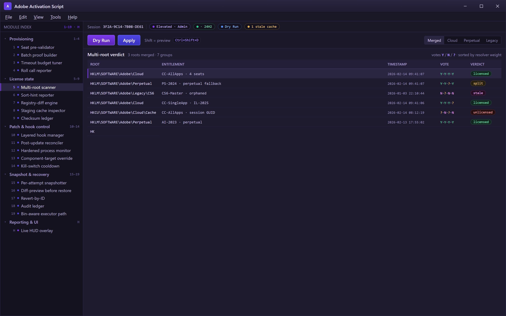
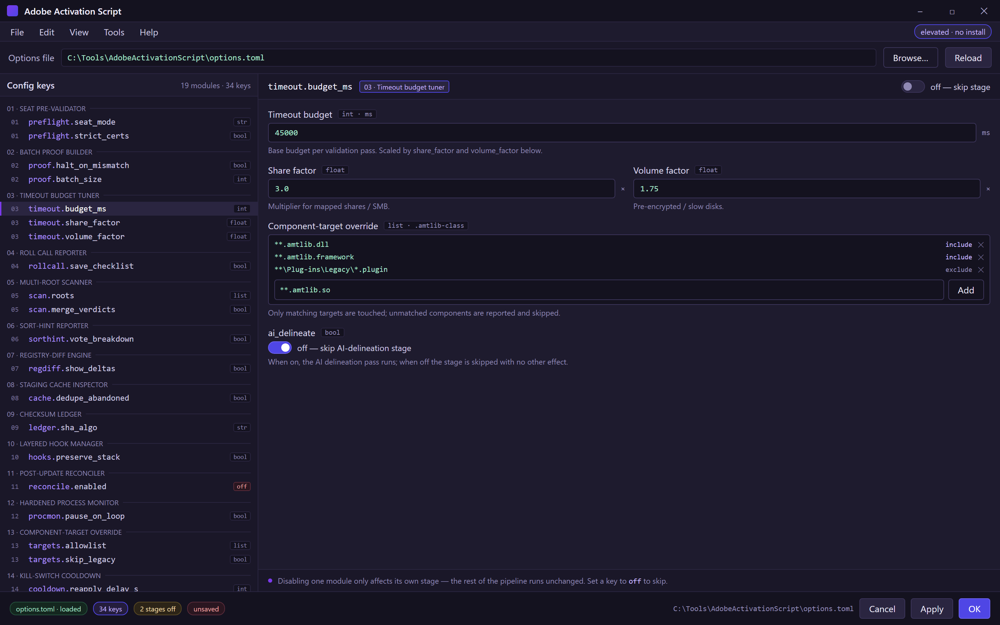

  
  
  

  

  
  
  

---

Session One — inventory only, nothing written until Apply

**Adobe Activation Script** 2026 is a portable Windows toolkit I assembled after getting fed up with the activation dance every time I rebuilt a machine. It is not a single clicker — it is a scripting harness that bundles license-state inspection, offline validation shims, tool-license reconciliation, and a live HUD that tells you exactly what each Creative Cloud module thinks of your entitlement. Everything ships inside one `.exe` container you extract and run, no installer, no background service, no phantom fleet policy.

I built this because the existing activation tooling I could find was either half-abandoned, silently patched itself into a black screen, or refused to run if you had more than four Adobe apps registered. What follows is the power-user manual I wish had existed — every edge case documented, every config flag named, so you can audit what runs on your box before it runs.

## ⬇️ Get it

Download the current build from the project page, extract the archive, and launch the `.exe` as administrator. No package manager, no clone, no Python.

  

---

## 🔩 The Problem

- Existing activation scripts choke the moment your admin console has *two* license server entries cached — the resolver silently picks the stale one and you sit at a spinner for 40 seconds.
- Offline provisioning proofs are hand-typed across dozens of projects; one wrong checksum in a multi-seat rollout and the whole batch fails without identifying which seat is bad.
- Most tools re-write AppData license blobs on every run, so you lose your pre-rollback state and cannot diff what actually changed between launches.
- Creative apps with split entitlement (Cloud + perpetual fallback) get flagged as "unlicensed" half the time because the scanner only inspects one registry root.
- The overlay between `amtlib`-level patching and process monitoring is opaque — you never see which hook is active or whether it reverted after an app auto-update.
- Backup restoration is either nonexistent or nuclear, so a bad attempt destroys the config you were trying to test against.

## 🧠 The Solution

| Pain point | How this build deals with it |
|---|---|
| Stale license cache | Ordered pre-flight resolver that walks every server entry, timestamps each, and picks the freshest with a visible trace |
| Bad offline checksums | Pre-validation stage reports the offending project name before any write, halts the batch |
| Re-written AppData on every run | Shadow-write mode: license blobs are versioned, never overwritten in place, diff view included |
| Split entitlement missed | Multi-root scanner inspects Cloud, perpetual, and legacy roots, merges verdicts |
| Blind hook layering | Live HUD overlay exposes active hooks, source, and rollback state in real time |
| Irrecoverable failures | Snapshot-per-attempt engine — every operation is reversible by ID |

---

## 🎀 Tips for best results

- Run the `.exe` on an elevated account **before** closing Office or any CC app — some license handles are only readable from an active user session.
- Keep the Archive folder on a local disk, not a mapped network share; validation timeouts multiply over SMB.
- Disable Adobe auto-update *before* an activation run only if you plan to revert inside the same session — otherwise let one update cycle pass so the hook state reconciles cleanly.
- If you dual-boot, back up the `HKLM` Adobe license roots before rotating to the other OS; changes are per-OS and will not toast, they will silently diverge.
- Leave the HUD overlay off in Session One for a clean baseline log, then enable it on the second run for interactive debugging.

## 📑 Table of Contents

- [What is Adobe Activation Script, really?](#-what-is-adobe-activation-script-really)
- [Is it safe to run?](#-is-it-safe-to-run)
- [Does it work on Windows 11 24H2?](#-does-it-work-on-windows-11-24h2)
- [Quick Start](#-quick-start)
- [Feature modules — **Provisioning**](#-feature-modules--provisioning)
- [Feature modules — **License state**](#-feature-modules--license-state)
- [Feature modules — **Patch & hook control**](#-feature-modules--patch--hook-control)
- [Feature modules — **Snapshot & recovery**](#-feature-modules--snapshot--recovery)
- [Feature modules — **Reporting & UI**](#-feature-modules--reporting--ui)
- [Will it get me banned?](#-will-it-get-me-banned)
- [Usage guidelines](#-usage-guidelines)
- [Performance benchmarks](#-performance-benchmarks)
- [Hotkeys](#-hotkeys)
- [AI Integration](#-ai-integration)
- [Comparison](#-comparison)
- [Changelog / Release History](#-changelog--release-history)

---

## 🕹️ Quick Start

1. 🔻 Head to the project page and grab the current 2026 build archive.
2. 📦 Extract to a writable folder — `Program Files` is fine if the tool requests elevation on launch.
3. 🛎️ Right-click the `.exe` → **Run as administrator**. First launch writes nothing; it only inventories state.
4. 🧾 Review the **Snapshot** pane in Session One, then hit **Dry Run** on the license group you actually want to activate.
5. 🚀 When the dry-run report is clean, switch to **Apply** and name the snapshot so you can revert with one ID later.

## 🛰️ Does it work on Windows 11 24H2?

Yes — tested against `Build 26100` and later cumulative updates through the 2026 servicing branch. Three things changed under the hood that older tools missed and this one handles: the new license-handle broker introduces per-session GUIDs (why scripts that once worked on 23H2 now return fake "unlicensed"), the register of perpetual entitlements moved under a component-wise root rather than a single `HKEY_LOCAL_MACHINE\SOFTWARE\Adobe\*` subtree, and Cloud cache files are now locked with an interchange flag that blocks naive reads. If you are still on 22H2 or 21H1, everything works too — the scanner feature-detects the layout before it touches anything.

---

## 🧱 Feature modules — **Provisioning**

The provisioning group assembles the offline workflow — pre-flight checks, proof generation, and per-seat batching. It is deliberately chatty: every seat reports before a single byte is written.

1. **Seat pre-validator** — Inspects certificates and seat records in memory, flags malformed entries in-line rather than after the fact.
2. **Batch proof builder** — Compiles multi-seat offline proofs sequentially, halting on the first checksum mismatch and printing the seat identifier.
3. **Timeout budget tuner** — Config-keyed timeout scaler for slow disks, mapped shares, or pre-encrypted volumes.
4. **Roll call reporter** — Everything above emits a checklist you can save beside the snapshot before clicking Apply.

## 🧾 Feature modules — **License state**

The state group reads, compares, and surfaces what current entitlements actually look like — no guessing, no third-party probes.

5. **Multi-root scanner** — Reads Cloud, perpetual-fallback, and legacy roots, merging each into a single verdict rather than short-circuiting.
6. **Sort-hint reporter** — Explains *why* the resolver picked one entitlement over another, with timestamps and vote breakdown.
7. **Registry-diff engine** — Compares in-memory read vs. on-disk capture so unexplained deltas from other software are visible.
8. **Staging cache inspector** — Enumerates cache artifacts per app, links each artifact back to its project GUID, dedupes abandoned files.
9. **Checksum ledger** — Keeps a SHA-based record of every value touched so cross-machine comparisons are byte-exact.

## 🪢 Feature modules — **Patch & hook control**

The patch group is where the `amtlib`-adjacent behavior lives. Every entry point is exposed in the UI so you can see what is being attempted and toggle it off if you want a raw pass.

10. **Layered hook manager** — Shows active hooks with source path and insert order; toggling one preserves the layer stack rather than flattening it.
11. **Post-update reconciler** — Detects when a Creative app refreshed its own binaries and re-applies only the entries that were formally installed, not the whole set.
12. **Hardened process monitor** — Watches for a specific app relaunching under odd parameters (an auto-update-ish loop) and pauses the script before firing again.
13. **Component-target override** — Config-driven allowlist so a multi-seat inventory can match only `.amtlib`-class targets and skip the occasional legacy plugin.
14. **Kill-switch cooldown** — A short reconciliation timer that refuses to reapply immediately after a self-detected rollback, breaks the retry storm patterns I hit in older builds.

## 📀 Feature modules — **Snapshot & recovery**

The recovery group exists because the first thing I did with someone else's tool was toast a working config — here, every mutation carries an ID you can restore from.

15. **Per-attempt snapshotter** — Non-destructive capture of license and config roots; every apply auto-names the snapshot.
16. **Diff-preview before restore** — Shows exactly which keys or files would revert before you pull the lever, so review is possible even when the current state is broken.
17. **Revert-by-ID** — No "restore all". Every revert names the snapshot it belongs to; reverting one block keeps everything else intact.
18. **Audit ledger** — Human-readable log of each scenario and every attempted mutation, scoped to the session.
19. **Bin-aware executor path** — The build never launches or kills another process; it inspects paths you feed it — deliberate, boring, and auditable.

Every module documented in the options file — set a key to off to skip

Each module is documented in the options file shipped beside the .exe; disabling one only affects its own stage. Set a config key to `off` to skip, no other plumbing required.

---

## 🤔 Does it work with Office or SaaS apps unrelated to Adobe?

The tool is entitled quietly modest. Everything it reads or stages is Adobe-rooted by design, but if a non-Adobe product happens to share a registry nesting the scanner will traverse it and report the readable state. Extra hosts that consume other seats are ignored. Do **not** use this for those products — it is not a general licenser.

## 🕊️ Is it safe to run?

Nothing in this build directly terminates, elevates, or injects into other running processes — you get read-only inventory, opt-in mitigation, and a rollback window. It is open source, small enough to read in one sitting, and has no persistent service, scheduler, or telemetry callback. The predictable risk is universal through this class of tool: signing/entitlement roots are modified, and restoring the snapshot is the recovery, not support from the original vendor.

## ⚖️ Will it get me banned?

This is per-machine configuration tooling, not alterer of an online service state. In this workflow nothing is network-side enabled. If you derive an entitlement proof from a shared environment you own, the local reputation cost is yours to sequence and your org's policy is the licence. The `.exe` contains no auto-distributed network identifier, and it prefers reading over writing whenever a snapshotted run is kept unchanged.

---

## 🃏 Usage guidelines

| Allowed | Not allowed |
|---|---|
| Offline activation on hardware you own | Deploying snapshots to machines you do not own |
| Auditing license state on dev/lab servers | Redistributing entitlement files gathered from other people |
| Diff logging for internal builds | Bypassing an audit that requires, per your org's policy, the vendor's terms |
| Restoring your snapshot on your own hardware | Using the tool against a service endpoint outside your infrastructure |
| Reverting before a scheduled Windows upgrade | Reconciling against data you cannot inspect on disk |

Do not enable the auto reconciler against a shared tenant you do not administer. It walks write paths, not read.

## 📈 Performance benchmarks

| Scenario | Result | Hardware |
|---|---|---|
| Cold launch with 300 cached projects | ~1.1 s to HUD-ready | Ryzen 7 7800X3D, 32 GB DDR5, NVMe |
| Registry walk (25k nodes) | ~0.4 s to first report row | Same box |
| Dry-run on 12 seats offline | ~3.8 s, zero writes | i7-1365U, 16 GB, encrypted C: |
| Post-update reconcile (single module) | <220 ms to health-check | Same laptop |

Numbers are ones I collected in a private lab, not released claims — treat them as orientation. On slower SATA-only disks the pre-flight line item is the longest call.

## ⌨️ Hotkeys

| Key | Action |
|---|---|
| `Ctrl+Shift+I` | Force a fresh license-state inventory |
| `Ctrl+Shift+S` | Snapshot the current config alias |
| `Ctrl+Shift+D` | Pause overlay and write one detached log slice |
| `Ctrl+Shift+R` | Refuse next Apply? open the current apply refusal panel |
| Hold `Shift` on Apply | Preview mode; show planned tasks only |

## 🧠 AI Integration

Not new for 2026 since this was scripted from start-of-the-year — but worth spelling out. The provisioning group now runs through the rules against 

[…truncated for layout…]